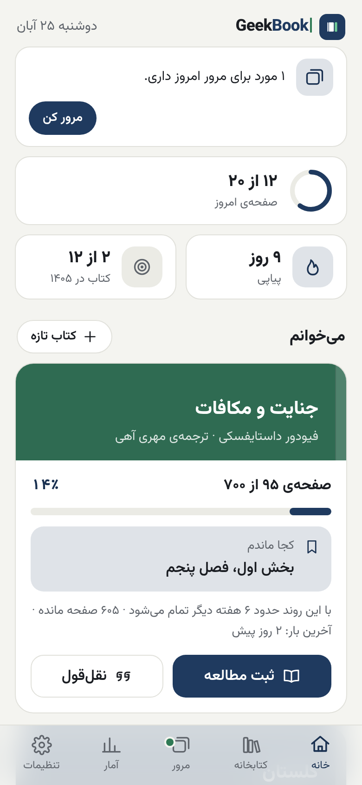
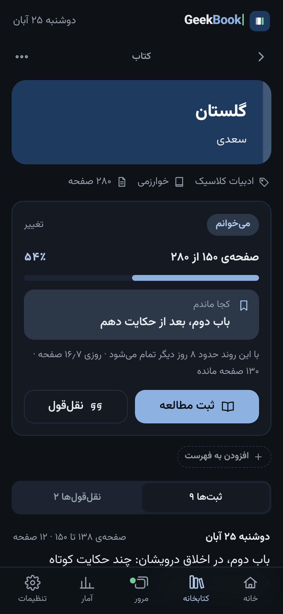

<p align="center">
  
</p>

<h1 align="center">GeekBook</h1>

<p align="center" dir="rtl">همراه کتاب‌خوان‌های کاغذی: کجا ماندم، چه خواندم و چه یادم مانده. ساده، فارسی و آفلاین.</p>
<p align="center">A companion for people who read paper books: where I stopped, what I read, and what stayed with me. Persian, right-to-left, fully offline.</p>

<p align="center"><a href="https://mani-imani.github.io/GeekBook/"><b>mani-imani.github.io/GeekBook</b></a></p>
<p align="center"><a href="#فارسی">فارسی</a> · <a href="#english">English</a> · <code>v1.0.1</code></p>

---

<div dir="rtl">

## فارسی

### چه کاری می‌کند

GeekBook برای کتاب کاغذی ساخته شده است. کتاب را با نام و مشخصاتش اضافه می‌کنید و هر بار که آن را می‌بندید، صفحه و جایی را که مانده‌اید ثبت می‌کنید. اگر بخواهید دو سه خط خلاصه هم از حفظ می‌نویسید و اپ آن را چند روز بعد برای مرور برمی‌گرداند. سرور ندارد، حساب کاربری ندارد و هیچ داده‌ای از دستگاه شما بیرون نمی‌رود.

### نمای اپ

<p align="center">
  
  
</p>

### ویژگی‌ها

- **کتابخانه:** ورود دستی و متنی (عنوان، نویسنده، مترجم، ناشر، موضوع، تعداد صفحه). عکس جلد ندارد؛ هر کتاب یک جلد رنگی با حرف اول عنوانش می‌گیرد.
- **وضعیت‌ها:** می‌خوانم، نخوانده، خوانده‌ام، رها شد، برای خرید.
- **کجا ماندم:** شماره‌ی صفحه و یک خط یادآوری، روی کارت کتاب در صفحه‌ی اول.
- **پیشرفت:** «صفحه‌ی ۱۴۰ از ۳۲۰»، درصد، و تخمین زمان پایان از روی میانگین دو هفته‌ی اخیر.
- **تاریخ شروع و پایان:** خودکار ثبت می‌شود و قابل ویرایش است (تاریخ شمسی).
- **فهرست خرید:** با قیمت، اولویت و جمع قیمت‌ها. با «خریدم» کتاب به کتابخانه می‌آید.
- **فهرست‌های دلخواه:** هر تعداد فهرست با نام خودتان؛ هر کتاب می‌تواند در چند فهرست باشد.
- **دفترچه‌ی امانت:** کدام کتاب دست چه کسی است و از چه روزی.
- **نقل‌قول:** متن، شماره‌ی صفحه و یادداشت.
- **خلاصه از حفظ:** هنگام ثبت مطالعه، دو سه خط به زبان خودتان.
- **مرور با فاصله:** خلاصه‌ها و نقل‌قول‌ها بعد از یک روز، یک هفته، یک ماه، سه ماه و شش ماه برمی‌گردند.
- **امتیاز و نظر کوتاه:** بعد از تمام شدن کتاب.
- **روزهای پیاپی و نقشه‌ی مطالعه:** نقشه‌ی یک سال اخیر بر اساس تقویم شمسی.
- **هدف:** صفحه در روز و کتاب در سال.
- **آمار:** صفحه در ماه، موضوع‌ها و نویسنده‌های پرتکرار، میانگین زمان تمام کردن کتاب.
- **جمع‌بندی سال:** برای هر سال شمسی، با تصویر آماده‌ی اشتراک.
- **کارت نقل‌قول:** تصویر در سه اندازه (پست، استوری، مربع) و سه رنگ.
- **خروجی Markdown:** مشخصات، نظر، خلاصه‌ها و نقل‌قول‌های هر کتاب در یک فایل.
- **پشتیبان:** خروجی و ورودی JSON، یادآوری پشتیبان‌گیری، درخواست ذخیره‌ی پایدار از مرورگر.
- **راهنما:** صفحه‌ی کوتاه «روش درست خواندن».
- **اپ:** روی صفحه‌ی اصلی گوشی نصب می‌شود و در حالت هواپیما هم کامل کار می‌کند.

### نصب روی گوشی

- **آیفون (Safari):** دکمه‌ی اشتراک‌گذاری، بعد Add to Home Screen.
- **اندروید (Chrome):** بنر «نصب» را بزنید، یا از منو گزینه‌ی Install app را انتخاب کنید.
- **کامپیوتر (Chrome یا Edge):** آیکون نصب در انتهای نوار آدرس.

در اولین بازدید، خود اپ هم پیشنهاد نصب را با راهنمای همان دستگاه نشان می‌دهد؛ بعد از آن از «تنظیمات» در دسترس است.

### پشتیبان‌گیری

داده‌ها در IndexedDB مرورگر ذخیره می‌شوند. اگر داده‌ی سایت را پاک کنید، ممکن است از دست بروند. برای همین:

1. هر چند وقت یک بار از **تنظیمات ← خروجی JSON** پشتیبان بگیرید.
2. برای برگرداندن: **تنظیمات ← ورودی JSON**. هر مورد با <code dir="ltr">id</code> شناخته می‌شود و نسخه‌ی تازه‌تر (<code dir="ltr">updated_at</code>) می‌ماند، پس وارد کردن دوباره‌ی یک فایل چیزی را تکراری نمی‌کند.

### اجرا روی سیستم خودتان

پروژه build step و وابستگی ندارد: فقط HTML، CSS و جاوااسکریپت (ES modules).

</div>

```bash
git clone https://github.com/mani-imani/GeekBook.git
cd GeekBook
python3 -m http.server 8080   # then open http://localhost:8080
```

<div dir="rtl">

### انتشار نسخه‌ی تازه

شماره‌ی نسخه را در دو جا یکی کنید: <code dir="ltr">js/version.js</code> و <code dir="ltr">sw.js</code>. اگر فایل تازه‌ای اضافه شد، نامش را به فهرست <code dir="ltr">ASSETS</code> در <code dir="ltr">sw.js</code> هم بدهید تا آفلاین در دسترس باشد.

### ساختار

</div>

```
index.html              app shell
manifest.webmanifest    PWA manifest
sw.js                   service worker (cache-first, offline)
css/style.css           all styles (GeekMani brand tokens, light and dark)
js/main.js              routing, navigation, banners, service worker registration
js/store.js             state + IndexedDB persistence, import/export, spaced review
js/db.js                small IndexedDB wrapper
js/stats.js             streaks, pace, yearly and monthly numbers
js/sheets.js            every form (add book, log reading, quote, loan, lists, …)
js/components.js        shared pieces (book rows, covers, stars, progress)
js/share.js             canvas share images (quote card, year recap)
js/markdown.js          Markdown export of one book
js/backup.js            JSON export/import
js/files.js             saving and sharing files
js/fmt.js, jalali.js    numbers, dates, Jalali calendar
js/ui.js                element builder, icons, toast, bottom sheet, form helpers
js/views/               home, library, book, review, stats, recap, settings, guide
assets/screenshots/      images for this README (not part of the app, not cached)
```

<div dir="rtl">

### ساختار داده

هر رکورد <code dir="ltr">id</code> (UUID)، <code dir="ltr">created_at</code>، <code dir="ltr">updated_at</code> و <code dir="ltr">deleted</code> دارد. همین سه چیز برای همگام‌سازی بین دستگاه‌ها در آینده کافی است: رکورد تازه‌تر می‌ماند و حذف‌ها هم منتقل می‌شوند.

</div>

| Store | Fields |
| --- | --- |
| `books` | title, author, translator, publisher, genre, pages, status, current_page, bookmark, started_at, finished_at, rating, review, drop_reason, price, priority, note, color, lists |
| `logs` | book_id, at, from_page, to_page, pages, summary, review_stage, next_review_at |
| `quotes` | book_id, text, page, note, review_stage, next_review_at |
| `lists` | name, sort_order |
| `loans` | book_id, person, lent_at, returned_at, note |

---

## English

GeekBook is a small, offline-first PWA for readers of physical books. Add a book by typing its details, and each time you close it, record the page you reached and one line about where you stopped. Optionally write a two-line summary from memory; it comes back for review after a day, a week, a month, three months and six months.

<p align="center">
  
  
</p>

Also included: five statuses (reading, unread, read, dropped, to buy), a to-buy list with prices, custom lists, a lending log, quotes with page numbers, rating and a short review, streaks, a Jalali heatmap, daily and yearly goals, a stats page, a year recap, share images for quotes and the recap, Markdown export per book, and JSON backup.

No server, no account, no tracking, no build step, no dependencies. Plain HTML, CSS and JavaScript modules; data lives in IndexedDB on the device.

Part of the [GeekMani](https://maniimani.ir) product family. MIT license. Vazirmatn font under the SIL Open Font License.
